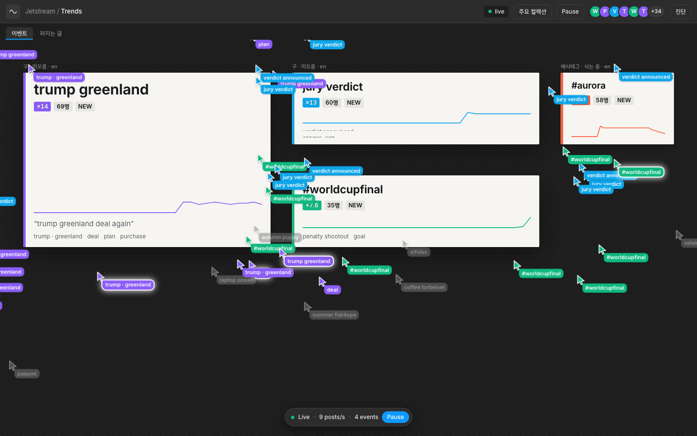

# Jetstream Trends

Real-time trend detection for every public Bluesky post, running entirely in the browser. No server, no backend aggregation.

**[Live demo](https://jetstream-phi.vercel.app)** · **[Case study](https://woodylovesboota.xyz/work/jetstream)**



The app subscribes to Bluesky Jetstream, the public WebSocket firehose, and finds what is spreading *unusually* right now. Each trend becomes a card on a canvas, drawn and labelled by a swarm of cursors. Every cursor is one real sampled post.

## What counts as a trend

> Something that appears far more than its own normal, across many different people, and is still growing.

Score = surprise (overdispersed z-score against the term's own baseline) × spread (unique authors, new joiners) × acceleration × novelty.

Always-popular words cannot rank on their own. A word like `trump` only surfaces when a word paired with it departs from normal, so the card reads `trump · greenland`, not `trump`.

## Numbers

All figures are measured, with raw data in [`docs/measurements`](docs/measurements) and [`docs/trend-engine`](docs/trend-engine).

| What | Result |
|---|---|
| Live stream handled | ~390 events/s, 1.4M events in a 60-minute recording |
| Main-thread long tasks (>50ms) | 0 |
| Frame time at 4× CPU throttle | p95 ≤ 10.1ms |
| Frame time while the worker is overloaded 28× | p95 < 10ms |
| Engine throughput, replayed offline | ~131K events/s, about 400× the live rate |
| Scoring pass, every 5s | p50 3.2ms, p95 3.9ms |
| Engine memory | ~27MB, flat after GC |
| Everyday words in the top 10 | 0% on real recordings |

Detection delay for a new topic injected into a real recording:

| Posts per minute | 12 | 24 | 48 | Bot ring (6 accounts, 400 posts) |
|---|---|---|---|---|
| Time to detect | 115s | 45s | 30s | Not detected, as intended |

## How it works

```
Jetstream WS ──▶ Web Worker: sample gate ▶ parse ▶ dedup ▶ aggregate ▶ discard
                      │
                      │  postMessage, fixed 10 snapshots/s
                      ▼
                 Main thread: keep latest snapshot in a ref ▶ draw on rAF
```

1. **The worker does everything.** Receiving, parsing, aggregation and trend scoring all run in a Web Worker. Raw events are dropped as soon as they are counted.
2. **Fixed 10Hz snapshots.** However fast events arrive, only ten fixed-size messages a second cross the thread boundary, so worker overload has no path to the renderer.
3. **The main thread only draws.** React mounts the shell. Cursors and cards are moved with `translate3d` in a `requestAnimationFrame` loop, so the data path never triggers a re-render.
4. **Fixed-size counting.** A Count-Min Sketch, a 30,000-slot tracked table and Space-Saving top-k keep memory flat as the stream grows.
5. **Three stages of backpressure.** Fixed snapshots, then sampled rows, then, only when input truly exceeds capacity, sampling *before* `JSON.parse`. WebSocket has no built-in backpressure, so the worker estimates its own utilization and sheds load on its own.
6. **Every drop is counted.** Each place that discards data has a counter shown in the HUD. Degraded numbers are never scaled up to look complete.
7. **Reconnects resume from a cursor.** Exponential backoff with jitter, failover across the four official Jetstream instances, and a replay of the gap without double counting.
8. **Cold start.** A prior built from a recording (`public/prior.json`, ~50KB gzipped) plus IndexedDB memory across sessions, so the first minutes are not noise.

Longer write-ups, in Korean: [architecture](docs/ARCHITECTURE.md), [measurements](docs/CASE-STUDY.md), [trend engine report](docs/trend-engine/FINAL_REPORT.md), [decision log](docs/trend-engine/DECISIONS.md).

## Testing

- **Unit (Vitest), about 150 tests.** Tokenizers for English, Korean, Chinese and Japanese, counters, baselines, scoring scenarios, clustering, swarm layout.
- **End to end (Playwright), 12 tests.** Run against a production build in fixture mode: cursors draw a card, a new trend appears, a cooling trend fades, zero console errors, zero long tasks, reduced motion, 900px and 390px widths.
- **Record and replay.** `pnpm record` captures the real stream, `pnpm replay` feeds it back through the engine and reports metrics, and `pnpm inject` mixes in fake topics and bot patterns to measure detection delay.

## Run locally

```bash
pnpm install
pnpm dev
```

Open http://localhost:3000. Add `?fixture=news` to play a deterministic synthetic stream instead of the live one, with no network needed.

| Command | What it does |
|---|---|
| `pnpm typecheck` / `pnpm lint` / `pnpm test` | Types, lint, unit tests |
| `pnpm build && pnpm test:e2e` | Playwright against the production build, in fixture mode |
| `pnpm record --minutes 60` | Record Jetstream to `recordings/*.jsonl.gz` |
| `pnpm replay --file rec.jsonl.gz [--prior public/prior.json]` | Replay a recording through the engine and report metrics |
| `pnpm build-prior --file rec.jsonl.gz` | Build `public/prior.json` from a recording |
| `pnpm inject [--file rec.jsonl.gz --prior …]` | Inject fake topics and bot patterns, measure detection delay |

## Project layout

```
src/trend/          Trend engine in pure TypeScript, no DOM or Worker dependency
lib/jetstream/      Worker, connection and reconnect, backpressure, protocol
components/swarm/   Cursor swarm and trend cards
lib/swarm/          Layout and motion math
scripts/            record, replay, build-prior, inject
e2e/                Playwright tests
docs/               Architecture, measurements, decisions
```

## Known limits

- The shipped prior comes from a one-hour recording, so there is no time-of-day profile yet. The code path exists and is tested; it needs a 48-hour recording.
- Slow-building topics (around 6 posts a minute) take about 3 minutes to detect. That is the trade-off for suppressing noise.
- Engine memory was measured in a Node replay, not inside the browser worker.

## Stack

Next.js 16 · React 19 · TypeScript · Web Worker · WebSocket · IndexedDB · TanStack Virtual · uPlot · Vitest · Playwright
